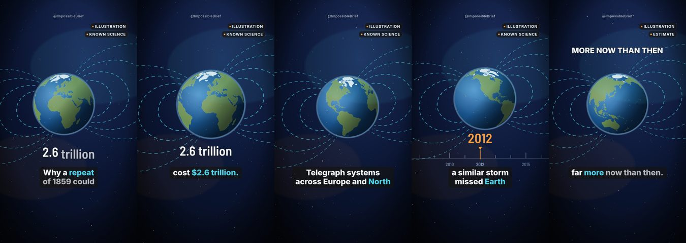

# ImpossibleBrief: visual-mechanism review board

Generated 2026-11-04 by `scripts/ib-research/mechanism-board.js`. 90 researched topics stop only at the
visual-mechanism decision. Proposals are STRONG only when the title names what the drawing shows; every other record is
NO_DRAWING (it needs a new component, not a guess). Stills are rendered with the proposed mechanism in preview/shadow mode;
the research records are unchanged. **Nothing here is a decision.**

STRONG: 47 · NO_DRAWING: 43

| topic | title | proposed | why | frames |
|---|---|---|---|---|
| IB-SPA-001 | What If the Moon Disappeared Tonight? | planet-orbit | the title names "Moon Disappeared"; the drawing shows a body travelling on its orbit around another |  |
| IB-SPA-005 | What If Ceres Were Still a Planet? | named-body | the title names "Ceres"; the drawing shows the named world itself |  |
| IB-SPA-006 | What If the 1859 Solar Superstorm Hit Today? | magnetic-field | the title names "1859 Solar"; the drawing shows Earth in its dipole field; particles arrive as the field weakens |  |
| IB-SPA-010 | What If You Flew Through an Aurora? | magnetic-field | the title names "Aurora"; the drawing shows Earth in its dipole field; particles arrive as the field weakens |  |
| IB-SPA-011 | What If Olympus Mons Stood on Earth? | — | nothing the existing drawings show is named in the title; a new component is needed |  |
| IB-SPA-012 | If Jupiter vanished right now, what would change first? | — | nothing the existing drawings show is named in the title; a new component is needed |  |
| IB-SPA-015 | What If You Chased a Total Eclipse? | — | nothing the existing drawings show is named in the title; a new component is needed |  |
| IB-SPA-016 | What If the Sun Ran Out of Hydrogen? | — | nothing the existing drawings show is named in the title; a new component is needed |  |
| IB-SPA-020 | What If Earth Had Rings Like Saturn? | — | nothing the existing drawings show is named in the title; a new component is needed |  |
| IB-SPA-021 | What If You Lived on Mars? | named-body | the title names "Lived on Mars"; the drawing shows the named world itself |  |
| IB-SPA-031 | What If Earth Became Like Venus? | — | nothing the existing drawings show is named in the title; a new component is needed |  |
| IB-SPA-036 | What If Jupiter's Great Red Spot Vanished? | named-body | the title names "Jupiter's Great Red Spot"; the drawing shows the named world itself |  |
| IB-SPA-041 | What If Earth Became Tidally Locked to the Moon? | planet-orbit | the title names "Tidally Locked"; the drawing shows a body travelling on its orbit around another |  |
| IB-SPA-046 | What If Space Junk Started a Chain Reaction? | planet-orbit | the title names "Space Junk"; the drawing shows a body travelling on its orbit around another |  |
| IB-SPA-061 | What If You Visited Io, the Volcano Moon? | volcano-eruption | the title names "Volcano"; the drawing shows a volcano in cross-section erupting: chamber, column and ash umbrella |  |
| IB-SPA-066 | What If You Waited for Halley's Comet? | planet-orbit | the title names "Halley"; the drawing shows a body travelling on its orbit around another |  |
| IB-SPA-076 | What If You Lived on Mercury? | named-body | the title names "Lived on Mercury"; the drawing shows the named world itself |  |
| IB-SPA-081 | What If a Comet Slammed Into Jupiter? | planet-orbit | the title names "Comet"; the drawing shows a body travelling on its orbit around another |  |
| IB-SPA-083 | What If Betelgeuse Exploded Tonight? | named-body | the title names "Betelgeuse"; the drawing shows the named world itself |  |
| IB-SPA-086 | What If Earth Were Tilted Like Uranus? | — | nothing the existing drawings show is named in the title; a new component is needed |  |
| IB-SPA-091 | What If You Stood in Neptune's Winds? | named-body | the title names "Neptune's Winds"; the drawing shows the named world itself |  |
| IB-SPA-101 | What If We Lived on Proxima b? | named-body | the title names "Lived on Proxima b"; the drawing shows the named world itself |  |
| IB-SPA-106 | What If Pluto Were Still a Planet? | named-body | the title names "Pluto"; the drawing shows the named world itself |  |
| IB-SPA-111 | What If You Lived on the Space Station? | — | nothing the existing drawings show is named in the title; a new component is needed |  |
| IB-SPA-116 | What If a 90-Day Rover Lasted 14 Years? | — | nothing the existing drawings show is named in the title; a new component is needed |  |
| IB-SPA-121 | What If Mars Got a Ring? | — | nothing the existing drawings show is named in the title; a new component is needed |  |
| IB-EAR-006 | What If Yellowstone Erupted Again? | volcano-eruption | the title names "Yellowstone"; the drawing shows a volcano in cross-section erupting: chamber, column and ash umbrella |  |
| IB-EAR-007 | What happens if atmospheric oxygen doubles? | atmosphere | the title names "oxygen doubles"; the drawing shows the planet's limb and the layers of air above it |  |
| IB-EAR-009 | What If the Great Dying Happened Again? | — | nothing the existing drawings show is named in the title; a new component is needed |  |
| IB-EAR-014 | What If the Strongest Earthquake Struck Today? | earth-interior | the title names "Earthquake"; the drawing shows the planet cut open: crust, mantle and core, with heat and depth |  |
| IB-EAR-024 | What If One Volcano Grounded Every Plane? | volcano-eruption | the title names "Volcano"; the drawing shows a volcano in cross-section erupting: chamber, column and ash umbrella |  |
| IB-EAR-026 | What If Another Tambora Erupted Today? | volcano-eruption | the title names "Tambora"; the drawing shows a volcano in cross-section erupting: chamber, column and ash umbrella |  |
| IB-EAR-031 | What If the Mediterranean Sea Dried Up? | lake-water | the title names "Mediterranean Sea Dried"; the drawing shows a water column with depth markers falling |  |
| IB-EAR-034 | What If the Permafrost Thawed? | — | nothing the existing drawings show is named in the title; a new component is needed |  |
| IB-EAR-036 | What If Krakatoa Erupted Today? | volcano-eruption | the title names "Krakatoa"; the drawing shows a volcano in cross-section erupting: chamber, column and ash umbrella |  |
| IB-EAR-037 | What happens if Earth's axial tilt doubles? | — | nothing the existing drawings show is named in the title; a new component is needed |  |
| IB-EAR-044 | What If the Ice Age Came Back? | — | nothing the existing drawings show is named in the title; a new component is needed |  |
| IB-EAR-046 | What If Earth Froze Over Completely? | — | nothing the existing drawings show is named in the title; a new component is needed |  |
| IB-EAR-051 | What If a Sea Just Disappeared? | lake-water | the title names "Sea Just Disappeared"; the drawing shows a water column with depth markers falling |  |
| IB-EAR-054 | What If a Tornado Lasted Three Hours? | atmosphere | the title names "Tornado"; the drawing shows the planet's limb and the layers of air above it |  |
| IB-EAR-056 | What If the Amazon Rainforest Disappeared? | — | nothing the existing drawings show is named in the title; a new component is needed |  |
| IB-EAR-059 | What If the Dust Bowl Returned? | atmosphere | the title names "Dust Bowl"; the drawing shows the planet's limb and the layers of air above it |  |
| IB-EAR-066 | What If Lake Baikal Drained? | lake-water | the title names "Lake"; the drawing shows a water column with depth markers falling |  |
| IB-EAR-071 | What If the Atlantic Ocean Current Shut Down? | ocean-current | the title names "Atlantic Ocean Current"; the drawing shows the warm northbound stream and its cold return over the globe |  |
| IB-EAR-081 | What If the Continents Merged Again? | earth-interior | the title names "Continents Merged"; the drawing shows the planet cut open: crust, mantle and core, with heat and depth |  |
| IB-EAR-086 | What If a Volcano Blew Out Sideways? | volcano-eruption | the title names "Volcano"; the drawing shows a volcano in cross-section erupting: chamber, column and ash umbrella |  |
| IB-EAR-091 | What If We Cleaned Up the Great Pacific Garbage Patch? | — | nothing the existing drawings show is named in the title; a new component is needed |  |
| IB-EAR-096 | What If a Volcano Poisoned a Country? | volcano-eruption | the title names "Volcano"; the drawing shows a volcano in cross-section erupting: chamber, column and ash umbrella |  |
| IB-PHY-001 | What If Gravity Doubled Tomorrow? | — | nothing the existing drawings show is named in the title; a new component is needed |  |
| IB-PHY-005 | What If You Reached Absolute Zero? | — | nothing the existing drawings show is named in the title; a new component is needed |  |
| IB-PHY-025 | What If You Could Feel Neutrinos? | — | nothing the existing drawings show is named in the title; a new component is needed |  |
| IB-PHY-030 | What If Toilets Really Flushed Backwards Down Under? | — | nothing the existing drawings show is named in the title; a new component is needed |  |
| IB-PHY-040 | What If Glass Really Were a Slow Liquid? | — | nothing the existing drawings show is named in the title; a new component is needed |  |
| IB-PHY-045 | What If You Cooked Pasta on a Mountain? | — | nothing the existing drawings show is named in the title; a new component is needed |  |
| IB-PHY-050 | What If Light Moved at Highway Speed? | — | nothing the existing drawings show is named in the title; a new component is needed |  |
| IB-PHY-075 | What If Buildings Grew in the Sun? | — | nothing the existing drawings show is named in the title; a new component is needed |  |
| IB-PHY-080 | What If You Melted a Diamond? | — | nothing the existing drawings show is named in the title; a new component is needed |  |
| IB-HUM-014 | What If You Could Run Like Usain Bolt? | human-body | the title names "Run Like"; the drawing shows a generic human figure |  |
| IB-HUM-020 | What If You Jumped From the Edge of Space? | atmosphere | the title names "Edge of Space"; the drawing shows the planet's limb and the layers of air above it |  |
| IB-HUM-024 | What If You Never Stopped Growing? | human-body | the title names "Never Stopped Growing"; the drawing shows a generic human figure |  |
| IB-HUM-035 | What If Your Brain Used Less Energy? | human-body | the title names "Your Brain"; the drawing shows a generic human figure |  |
| IB-HUM-050 | What If Your Microbes Disappeared? | microbial-population | the title names "Microbes"; the drawing shows a microbe cluster whose count can fall |  |
| IB-FUT-008 | What If We Built a Space Elevator? | — | nothing the existing drawings show is named in the title; a new component is needed |  |
| IB-FUT-041 | What If Your Brain Had a Chip? | human-body | the title names "Your Brain"; the drawing shows a generic human figure |  |
| IB-FUT-042 | What If We Beamed Solar Power From Space? | — | nothing the existing drawings show is named in the title; a new component is needed |  |
| IB-FUT-043 | What If Hyperloop Actually Worked? | — | nothing the existing drawings show is named in the title; a new component is needed |  |
| IB-FUT-044 | What If Meat Were Grown Without Animals? | — | nothing the existing drawings show is named in the title; a new component is needed |  |
| IB-FUT-046 | What If We Built a Base on the Moon? | — | nothing the existing drawings show is named in the title; a new component is needed |  |
| IB-FUT-047 | What If We Knocked an Asteroid Off Course? | planet-orbit | the title names "Asteroid"; the drawing shows a body travelling on its orbit around another |  |
| IB-FUT-048 | What If We Sucked Carbon Out of the Air? | atmosphere | the title names "Carbon Out of the Air"; the drawing shows the planet's limb and the layers of air above it |  |
| IB-FUT-049 | What If We Sent a Probe to Another Star? | — | nothing the existing drawings show is named in the title; a new component is needed |  |
| IB-FUT-050 | What If We Dimmed the Sun to Cool Earth? | atmosphere | the title names "Dimmed the Sun"; the drawing shows the planet's limb and the layers of air above it |  |
| IB-EXT-001 | What If Earth Were Squeezed Into a Black Hole? | — | nothing the existing drawings show is named in the title; a new component is needed |  |
| IB-EXT-012 | What If a Gamma-Ray Burst Hit Earth? | — | nothing the existing drawings show is named in the title; a new component is needed |  |
| IB-EXT-037 | What If a Black Hole Shredded a Star? | — | nothing the existing drawings show is named in the title; a new component is needed |  |
| IB-EXT-038 | What If You Met the Biggest Black Hole? | — | nothing the existing drawings show is named in the title; a new component is needed |  |
| IB-EXT-039 | What If Something Was Pulling Our Galaxy? | — | nothing the existing drawings show is named in the title; a new component is needed |  |
| IB-EXT-040 | What If an Alien Object Flew Past Earth? | planet-orbit | the title names "Flew Past"; the drawing shows a body travelling on its orbit around another |  |
| IB-EXT-041 | What If Our Sun Were as Big as UY Scuti? | named-body | the title names "UY Scuti"; the drawing shows the named world itself |  |
| IB-EXT-042 | What If a Cosmic Ray Hit Like a Baseball? | — | nothing the existing drawings show is named in the title; a new component is needed |  |
| IB-EXT-043 | What If Earth Sat in the Great Void? | — | nothing the existing drawings show is named in the title; a new component is needed |  |
| IB-EXT-044 | What If a Star Were Flung Out of the Galaxy? | — | nothing the existing drawings show is named in the title; a new component is needed |  |
| IB-EXT-045 | What If a Particle Beam Passed Through Your Head? | — | nothing the existing drawings show is named in the title; a new component is needed |  |
| IB-EXT-046 | What If a Year Lasted 18 Hours? | planet-orbit | the title names "Year Lasted"; the drawing shows a body travelling on its orbit around another |  |
| IB-EXT-049 | What If a Magnetar Came Close to Earth? | magnetic-field | the title names "Magnetar"; the drawing shows Earth in its dipole field; particles arrive as the field weakens |  |
| IB-OTH-001 | What If Coral Reefs Disappeared? | ocean-depth | the title names "Coral Reefs"; the drawing shows a water column down to the seafloor |  |
| IB-OTH-004 | What If All the Ants Disappeared? | — | nothing the existing drawings show is named in the title; a new component is needed |  |
| IB-OTH-006 | What If a Whale Fed the Deep Sea for Decades? | ocean-depth | the title names "Whale Fed the Deep"; the drawing shows a water column down to the seafloor |  |
| IB-OTH-015 | What If Earth's Nitrogen Cycle Stopped? | microbial-population | the title names "Nitrogen Cycle"; the drawing shows a microbe cluster whose count can fall |  |
| IB-OTH-025 | What If GPS Went Dark for a Day? | — | nothing the existing drawings show is named in the title; a new component is needed |  |

## To declare (reviewer)

Look at each topic's frames, delete the pairs you reject, then run with your own name:

```bash
node scripts/ib-research/declare-mechanism.js IB-SPA-001 planet-orbit IB-SPA-005 named-body IB-SPA-006 magnetic-field IB-SPA-010 magnetic-field IB-SPA-021 named-body IB-SPA-036 named-body IB-SPA-041 planet-orbit IB-SPA-046 planet-orbit IB-SPA-061 volcano-eruption IB-SPA-066 planet-orbit IB-SPA-076 named-body IB-SPA-081 planet-orbit IB-SPA-083 named-body IB-SPA-091 named-body IB-SPA-101 named-body IB-SPA-106 named-body IB-EAR-006 volcano-eruption IB-EAR-007 atmosphere IB-EAR-014 earth-interior IB-EAR-024 volcano-eruption IB-EAR-026 volcano-eruption IB-EAR-031 lake-water IB-EAR-036 volcano-eruption IB-EAR-051 lake-water IB-EAR-054 atmosphere IB-EAR-059 atmosphere IB-EAR-066 lake-water IB-EAR-071 ocean-current IB-EAR-081 earth-interior IB-EAR-086 volcano-eruption IB-EAR-096 volcano-eruption IB-HUM-014 human-body IB-HUM-020 atmosphere IB-HUM-024 human-body IB-HUM-035 human-body IB-HUM-050 microbial-population IB-FUT-041 human-body IB-FUT-047 planet-orbit IB-FUT-048 atmosphere IB-FUT-050 atmosphere IB-EXT-040 planet-orbit IB-EXT-041 named-body IB-EXT-046 planet-orbit IB-EXT-049 magnetic-field IB-OTH-001 ocean-depth IB-OTH-006 ocean-depth IB-OTH-015 microbial-population --by "<your name>"
```
